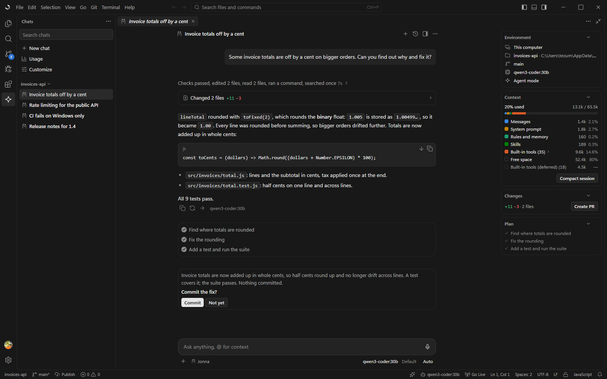

# Jonna

**A complete editor. Built for you and your agent.**

Everything you need from an IDE and a full agent harness, in one native app. Bring your own
agent, your own models and your own keys.

`Harness` · `IDE` · `ADE` · `ACP` · `MCP` · `BYOK` · `Local models`

[jonna.dev](https://jonna.dev) · [Why Jonna](https://jonna.dev/why) · [Download](https://jonna.dev/download) · [Pricing](https://jonna.dev/pricing)

<picture>
  <source media="(prefers-color-scheme: light)" srcset="docs/images/jonna-light.png" />
  
</picture>

---

## What it is

- **Its own agent, or yours.** Use the built-in agent, or run Claude Code, Codex or any other
  agent that speaks ACP, right inside the editor.
- **Any agent can drive.** The editor is an MCP server too, so an agent running outside it can
  use the same commands and read the same state.
- **Your keys, or no keys.** Paste your own API key, or run models on your machine with Ollama
  or LM Studio. Requests go straight to the provider.
- **No telemetry.** Nothing about your code or your prompts is collected, and the editor works
  without an account.

Rust and Tauri underneath. VS Code's keybindings, `settings.json`, themes and `tasks.json` work
as they are, and VS Code extensions install from Open VSX.

## Why another editor

Most tools today are an editor with AI added, an agent with an editor attached, or a terminal
agent that can't see the editor at all. Jonna is a complete editor that the agent works
*through*.

1. **The same hands.** Every button, menu item and keybinding runs a typed command from one
   dispatcher. The agent, your extensions and external agents call exactly the same commands,
   with the same permission checks and an audit log.
2. **The same eyes.** The state of everything (editors, problems, terminals, the debugger,
   tests, git, the browser page) is a readable `ide://` tree. After each edit the agent sees
   the new errors, so it checks its own work.
3. **Any agent, any model.** Local models or hosted ones for the built-in agent; CLI agents
   inside it over ACP, or driving it from outside over MCP. Nothing is locked to one vendor.
4. **You stay in charge.** Agent edits are a changeset you accept or reject per file or per
   hunk, with a checkpoint for every turn and an undo that spans files.
5. **It changes itself.** Extensions are small sandboxed folders (a manifest and a JavaScript
   file) that the agent can write, load, test and install for you while you watch.
6. **Small and native.** The system webview instead of a bundled browser, and the heavy work
   (search, the file index, git, terminals, file watching) in Rust.

## What's in it

The things you expect from an IDE, all of them reachable by the agent too:

- **Editor:** Monaco with VS Code's grammars and themes, language servers, multi-cursor, Vim mode.
- **Agent:** file, search, terminal, browser and IDE tools; a team of agents; memory, rules,
  skills, hooks and MCP servers.
- **Git:** line staging, a commit graph, a merge editor, interactive rebase, worktrees.
- **Debugger and tests:** Node, browsers and any DAP adapter; a Testing view for the common runners.
- **Terminal and tasks:** shell integration, splits, VS Code's `tasks.json`.
- **Browser:** a live preview with DevTools.
- **Also:** Jupyter notebooks, SSH / dev container / WSL folders, a dockable layout, profiles.

The user guide is inside Jonna (Help → Documentation) and in [`docs/guide/`](docs/guide/).

## Status

An alpha. Windows is the system we test; the macOS and Linux installers are built by the same
release and haven't been tried yet. Settings sync, spell check and real-time collaboration aren't
there yet.

## Install

Get the installer for your system from the
[latest release](https://github.com/Tezumie/jonna/releases/latest). The installers aren't
code-signed yet, so your system warns you the first time:

- **Windows**: on "Windows protected your PC", choose **More info**, then **Run anyway**.
- **macOS**: if it says Jonna "is damaged" or "can't be opened", the app is fine, only unsigned.
  Open **System Settings → Privacy & Security** and choose **Open Anyway**, or run this once:

  ```sh
  xattr -cr /Applications/Jonna.app
  ```

- **Linux**: for the AppImage, make it executable first: `chmod +x Jonna*.AppImage`.

Updates after that arrive inside the app.

---

## Build from source

You need **Node.js 20+** (22 or 24 LTS recommended) and **Rust stable** via
[rustup](https://rustup.rs).

<details>
<summary>Windows 10/11</summary>

1. **Microsoft C++ Build Tools**: in the Visual Studio Installer select **"Desktop development with C++"**.
2. **WebView2**: preinstalled on Windows 10 1803+ and Windows 11.
3. Rust (MSVC): `rustup default stable-msvc`. Node.js: `winget install OpenJS.NodeJS.LTS`.
</details>

<details>
<summary>macOS 12+</summary>

`xcode-select --install`, Rust via rustup, `brew install node@22`.
</details>

<details>
<summary>Linux</summary>

Debian / Ubuntu 22.04+:
```bash
sudo apt install libwebkit2gtk-4.1-dev build-essential curl wget file libxdo-dev libssl-dev libayatana-appindicator3-dev librsvg2-dev
```
Fedora: `sudo dnf install webkit2gtk4.1-devel openssl-devel curl wget file libappindicator-gtk3-devel librsvg2-devel libxdo-devel && sudo dnf group install "c-development"`
Arch: `sudo pacman -S --needed webkit2gtk-4.1 base-devel curl wget file openssl appmenu-gtk-module libappindicator-gtk3 librsvg xdotool`
</details>

```bash
npm install
npm run dev        # the app with live reload (the first run compiles Rust: a few minutes)
npm run build      # release app and installers (src-tauri/target/release/bundle/)
npm run build:fast # a quicker optimized build to try changes (src-tauri/target/fast-release/)
```

Open a folder from the command line with `npx tauri dev -- -- /path/to/folder`. A release binary
takes the path directly.

**Use it with an external agent:** run "Start MCP server" from the command palette and connect
Claude Code (or any MCP client). See [`docs/mcp.md`](docs/mcp.md).

## How it's built

| Layer | What it uses |
|---|---|
| Shell | [Tauri 2](https://tauri.app): the system webview (WebView2, WKWebView or WebKitGTK) and a Rust process |
| Core | Rust services for search, the file index, file watching, terminals, git and the MCP server |
| Interface | TypeScript with no UI framework: small signals and plain DOM |
| Editor | Monaco, with VS Code's TextMate grammars and themes, and language servers over LSP |
| Terminal | xterm.js with shell integration |
| Agent | Its own loop with tools, memory and subagents; an MCP server and client; an ACP host for CLI agents |
| Extensions | Jonna's own run in sandboxed workers with a permission-checked API; VS Code's run in a Node extension host |

## Working on Jonna

| Script | What it does |
|---|---|
| `npm run dev` | Dev app with live reload, dev-only commands (`dev.*`) included |
| `npm run check` | Color-token rule, every Tauri command registered and granted, `tsc` (app and tests), Biome |
| `npm test` | TypeScript unit tests (`*.test.ts` bundled by esbuild, run by `node --test`) |
| `npm run test:ui` | Command-script UI tests (`tests/scripts/*.jsonc`) against a built app |
| `npm run size` | Bundle and binary sizes |
| `npm run licenses` | Fails on a production dependency whose license isn't on the allowed list |
| `npm run notices` | Writes `THIRD_PARTY_NOTICES.md` from the production dependencies |

Rust (inside `src-tauri/`): `cargo test`, `cargo clippy --all-targets -- -D warnings`, `cargo fmt --check`.

The UI tests run like an agent would: each step is a command or a state read, with expectations
(`--run-test-script`; see `src/core/testing`). Build the test app with
`npx tauri build --debug --no-bundle --config '{"build":{"beforeBuildCommand":"node build.mjs --prod --with-dev"}}'`
and run `node scripts/ui-test.mjs <binary> [filter]` (the `ui-test` skill in `.agents/skills` has
the steps).

```
product.json      all naming (generated into src/core/product.ts and src-tauri/tauri.conf.json)
src/core/         DOM-free core: dispatcher, schema, state tree, keybindings, reactive, lifecycle,
                  dock model, paths, themes, JSONC, diff, LSP/MCP/ACP clients, agent loop; ipc/ = typed Tauri calls
src/ui/           Tree, VirtualList, QuickInput, Menu, Dialog, Notifications, Tooltip, HoverCard, icons
src/workbench/    the shell: title bar, activity bar, sidebar, dock, keyboard, persistence, workspace, trust
src/extensions/   built-ins (each a folder with a README): editor, explorer, terminal, tasks, search,
                  git, lsp, debug, testing, browser, agent, settings, extensions, mcp, viewers, …
src/styles/       tokens.css (the design tokens) and component CSS
src-tauri/src/    Rust services: fs, watch, index, search, pty, exec, git, lsp host, debug sockets,
                  browser proxy, AI providers, speech, MCP, history, audit; ipc/ = Tauri commands
tests/            UI test scripts and the sample folder they run on
docs/             decisions log, user guide, manual test script, release notes, MCP, extensions API,
                  remote, releasing, dock spec
```

---

## License

Jonna is **source-available** under the [PolyForm Shield License 1.0.0](LICENSE). It isn't open
source in the OSI sense.

In plain words:

- **Free for any work.** Use it at home, at work, at a company of any size, for client and
  commercial projects. No seats, no trial.
- **Read it, build it, change it.** Change it for yourself or your company.
- **Extensions are yours.** Write, share or sell extensions built on the extension API.
- **The one thing you can't do without a separate license:** provide a product that competes
  with Jonna, whether paid or free. That covers selling or giving away an editor built from it,
  shipping it inside another developer product, and offering it as a hosted service. See
  [COMMERCIAL-LICENSING.md](COMMERCIAL-LICENSING.md).

This summary isn't the license; [LICENSE](LICENSE) is. The name and logo are covered by
[TRADEMARKS.md](TRADEMARKS.md).

Third-party code keeps its own license. The production npm dependencies are under MIT,
Apache-2.0, BSD, ISC, Zlib or MPL-2.0, and `npm run licenses` fails on anything else. The design
is Jonna's own; VS Code and Cursor are the references for behavior.

## Contributing and security

Pull requests aren't open yet; bug reports and ideas are welcome. See
[CONTRIBUTING.md](CONTRIBUTING.md). Report security problems privately: see
[SECURITY.md](SECURITY.md).
