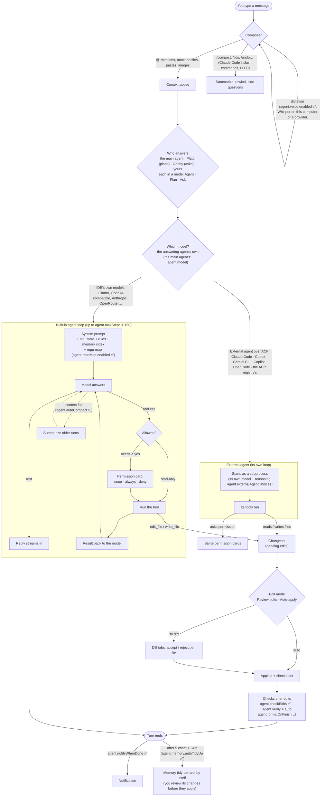
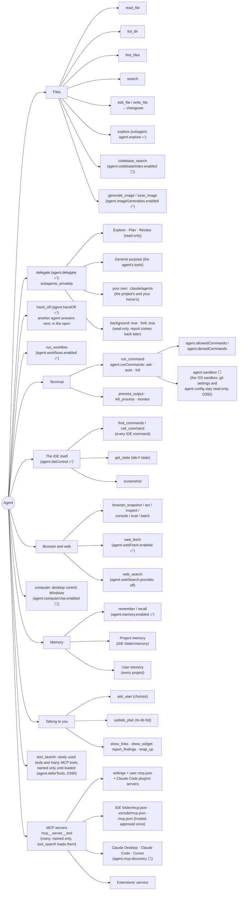
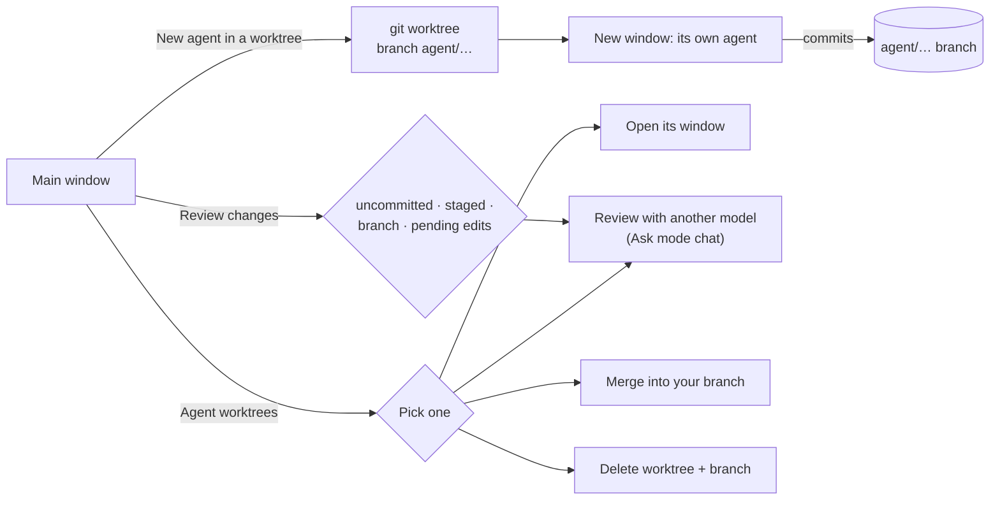
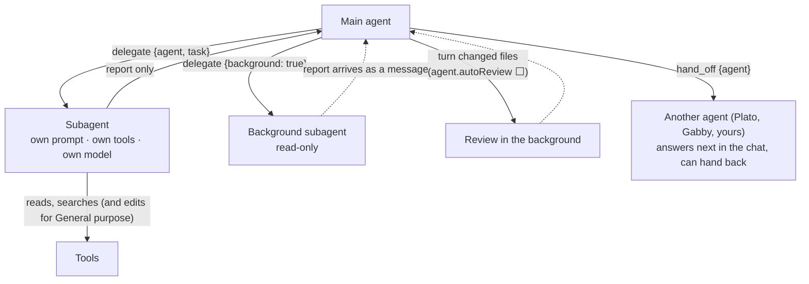

# How the agent works

A map of the IDE's agent: what happens on each message, everything it can use, and every switch
that changes it. ✅ means on by default and ⬜ off by default. Setting names are in `code`. The
Agents page (`agent.showAgentConfig`, D195, D286–D288) and Customize (`agent.customize`) are
diagram 3 as live screens.

## 1. One message, start to finish



## 2. What the agent can use



## 3. Everything you can configure

```mermaid
flowchart LR
  ROOT((Agent))

  ROOT --> MC[Models and context]
  subgraph MCg[" "]
    MC1["Main agent · agent.model (a model or an external agent)<br/>each of your agents: one model of its own"]
    MC2["Reasoning · agent.thinking = auto<br/>Effort · agent.effort = default"]
    MC3["Context length · 16k local · 200k cloud<br/>Prompt cache · 5m"]
    MC4["Ollama ✅ · custom providers"]
    MC5["Backup model · agent.fallbackModel"]
  end
  MC --> MC1 & MC2 & MC3 & MC4 & MC5

  ROOT --> FM[Models for each feature]
  subgraph FMg[" "]
    FM1["Edit with AI ⬜"]
    FM2["Suggestions as you type ⬜"]
    FM3["Next-edit suggestions ⬜"]
    FM4["Commit messages ✅"]
    FM5["Memory tidy-up ✅"]
  end
  FM --> FM1 & FM2 & FM3 & FM4 & FM5

  ROOT --> EA[External agents]
  subgraph EAg[" "]
    EA1["Claude Code · Codex · Gemini CLI · Copilot · OpenCode"]
    EA2["Each one's model + reasoning"]
    EA3["Custom ACP agents · the ACP registry's"]
  end
  EA --> EA1 & EA2 & EA3

  ROOT --> SUB[Agents, subagents and helpers]
  subgraph SUBg[" "]
    SUB1["Explore ✅ · Plan ✅ · Review ✅ · General purpose ✅<br/>each: on/off + model (agent.subagents)"]
    SUB2["Your own agents (the agents folders)<br/>and subagents (.claude/agents)"]
    SUB3["Review automatically ⬜ (agent.autoReview)"]
    SUB4["Agents in worktrees · Review changes"]
    SUB5["Hand off to each other ✅ (agent.handOff)"]
  end
  SUB --> SUB1 & SUB2 & SUB3 & SUB4 & SUB5

  ROOT --> CV[Conversation]
  subgraph CVg[" "]
    CV1["Stream text ✅ · auto titles ✅ · rich blocks ✅"]
    CV2["Ctrl+Enter to send ⬜ · while working: queue"]
    CV3["Notify when done ✅ · dictation ✅<br/>Output style · status line · phone webhook"]
  end
  CV --> CV1 & CV2 & CV3

  ROOT --> CT[Context and tools]
  subgraph CTg[" "]
    CT1["Repo map ✅ · auto-compact ✅ · max steps 150"]
    CT2["Web fetch ✅ · auto-approve ⬜ · web search (off)"]
    CT3["Read other tools' rules ✅ · skills · plugins"]
    CT4["Memory ✅ · images ✅ · codebase index ⬜"]
  end
  CT --> CT1 & CT2 & CT3 & CT4

  ROOT --> EX[Execution and approvals]
  subgraph EXg[" "]
    EX1["Commands: ask · auto · full access<br/>Sandbox ⬜ (agent.sandbox)"]
    EX2["Allowed / denied commands · auto-approve per kind"]
    EX3["IDE control ✅ · close what it opened ⬜<br/>Desktop control ⬜ (Windows)"]
    EX4["Protection: browser ⬜ · MCP ⬜ · deletes ⬜"]
  end
  EX --> EX1 & EX2 & EX3 & EX4

  ROOT --> AP[Applying changes]
  subgraph APg[" "]
    AP1["Edit mode: review · auto-apply"]
    AP2["Check edits ✅ · verify auto"]
    AP3["Format on finish ⬜"]
    AP4["Reload browser ✅ · open dev servers ✅<br/>Follow the agent's edits ⬜ (agent.followEdits)"]
  end
  AP --> AP1 & AP2 & AP3 & AP4

  ROOT --> IN[Integrations]
  subgraph INg[" "]
    IN1["MCP servers (files + settings)"]
    IN2["Other tools' MCP servers ⬜"]
    IN3["The IDE's own MCP server ⬜"]
  end
  IN --> IN1 & IN2 & IN3
```



## 4. Working in parallel and checking work



## 5. Subagents



Subagents never get `delegate` or `hand_off`. Each agent's file can list the subagents it may run
(`subagents:`; no key means all, `none` means none).

Subagent files (`.claude/agents/*.md`, in the project or your home folder) use Claude Code's
format:

```md
---
name: test-runner
description: Runs the tests and fixes what fails. Use after changing code.
tools: read_file, search, run_command      (Read, Grep, Bash… work too)
model: inherit                              (or provider/model, or sonnet / opus / haiku)
permissionMode: plan                        (optional: read-only)
maxTurns: 30                                (optional)
---
You run the project's tests…
```
